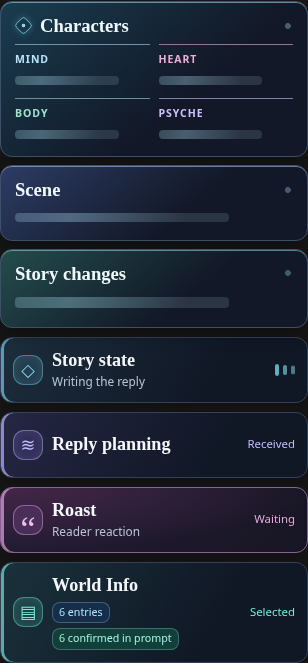
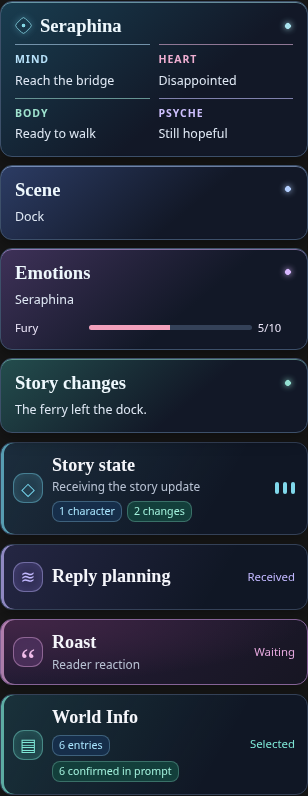
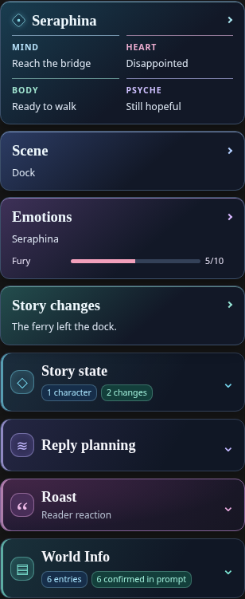

# Reply cards during generation and after saving

The 10.0.28 extension used a separate four-stage dashboard during generation. Its labels lit up, then the entire dashboard disappeared and a different set of illustrated cards took its place. Extension 10.0.29 uses the same card layout and typography for both phases.

## What the phone-width test showed

These are Chromium captures of the same reply in SillyTavern at a 390-pixel viewport. The model endpoint streamed a repeatable fixture so the reviewer could stop at specific stages. Each image shows the extension's card stack within the assistant message.

| Writing | Receiving structured fields | Saved |
| --- | --- | --- |
|  |  |  |

- During generation, the labels Mind, Heart, Body and Psyche occupy their final positions. Only complete update sections supply values. On the fixture, the preview and saved character card had identical field text, width and background. The ordered card titles matched on both sides of filing.
- The Roast kept its separate plum header. Opening the saved Roast showed its formatted paragraphs and emphasis. Tapping the saved character or Scene preview opened the corresponding Story state tab. The live previews displayed dots during generation and exposed no buttons or disclosures.
- Turning off **Show arriving story sections** left one status line. Disabling Roast display or World Info display removed those previews individually. Reduced motion retained the text and field values and disabled the shimmer and arrival animation.
- Stopping a stream after its scene section arrived cleared the preview. The unfinished fact did not appear in the Story World, and the unsaved location did not appear in the scene header. The normal completed turn used one generation request.
- The independent reviewer found chevrons on inert previews and a phone viewport that could finish with the prose above the screen. The chevrons now appear when the cards become interactive. On the fresh-chat retest the reviewer left the chat untouched from Send through filing. The final prose lines and the whole first character card were visible together. The reviewer then opened Scene, Reply planning, Roast and World Info and checked their contents. [Settled phone viewport](audit-evidence-10.0.29/phone-handoff.png)

## Reproduction and scope

The main host regression imports the companion preset, sends a streamed reply, tests compact display, compares preview and saved values, opens character detail, and stops a later partial stream. The reply-card test exercises a non-streaming reply, taps the saved Changes, character and Roast controls, checks formatting, and checks the wider layout. Two earlier card suites cover legacy cards. The stream-parser tests cover partial JSON, current-reply evidence, player filtering and emotion values. These runs used SillyTavern, Chromium and a controlled local endpoint. Physical TauriTavern rendering and provider-specific chunk timing remain unverified. [Streaming test](../tests/t_v10.js) · [Saved cards test](../tests/t_reply_cards_v103.js) · [Parser test](../tests/unit/stream_update.mjs)

| Check | Result |
| --- | --- |
| `tests/t_v10.js` | Passed. Includes streamed arrival, display controls, handoff and cancellation. |
| `tests/t_reply_cards_v103.js` | Passed. Includes touch-width disclosure interaction and desktop column layout. |
| `tests/t_cards.js` and `tests/t_reply_cards.js` | Both passed for the earlier card formats. |
| `node --test tests/unit/*.mjs tests/unit/*.cjs` | 20 passed. |
